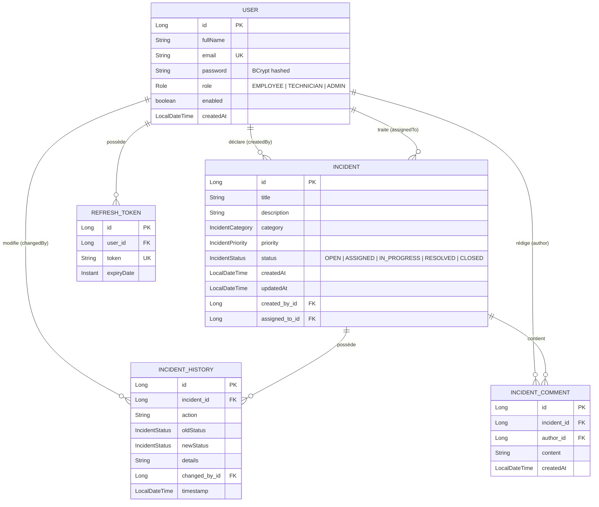

# 🛡️ Plateforme de Gestion des Incidents de Sécurité (Incident Management)

[](https://spring.io/projects/spring-boot)
[](https://spring.io/projects/spring-security)
[](https://react.dev/)
[](https://vitejs.dev/)
[]()

> **Projet / Devoir d'Application : Sécurité des Systèmes Distribués**  
> **Authentification et Autorisation avec Spring Security, JWT et React**

---

## 📋 Table des matières

1. [Contexte et Objectifs](#-contexte-et-objectifs)
2. [Architecture Générale](#-architecture-générale)
3. [Modèle de Données & Relations JPA](#-modèle-de-données--relations-jpa)
4. [Gestion de la Sécurité & JWT](#-gestion-de-la-sécurité--jwt)
5. [Contrôle d'Accès par Rôle (RBAC)](#-contrôle-daccès-par-rôle-rbac)
6. [Comptes de Test Préconfigurés](#-comptes-de-test-préconfigurés)
7. [Répertoire des Endpoints API](#-répertoire-des-endpoints-api)
8. [Gestion des Exceptions & Codes HTTP](#-gestion-des-exceptions--codes-http)
9. [Interface Frontend React](#-interface-frontend-react)
10. [Tests de Sécurité Automatisés (Section 25)](#-tests-de-sécurité-automatisés-section-25)
11. [Instructions de Démarrage](#-instructions-de-démarrage)

---

## 🎯 Contexte et Objectifs

Cette application web permet aux collaborateurs d'une entreprise de déclarer, traiter et superviser des incidents informatiques et de cybersécurité (attaques par ransomware, campagnes de phishing, fuites de données, pannes réseau, etc.).

L'application garantit une **sécurité de bout en bout** :
- **Authentification sans état (Stateless)** basée sur des jetons **JWT (JSON Web Token)** et un mécanisme de **Refresh Token**.
- **Contrôle d'accès basé sur les rôles (RBAC)** strict côté backend et répercuté côté frontend.
- **Vérification d'appartenance (Data Ownership)** : protection contre les attaques de type IDOR (un employé ne peut en aucun cas accéder aux incidents d'un tiers).
- **Audit et traçabilité** : journalisation immuable de chaque étape du cycle de vie de l'incident (`IncidentHistory`) et des notes techniques d'intervention (`IncidentComment`).
- **Validation stricte des données entrantes** via Bean Validation (`@Valid`, `@NotBlank`, `@Size`, etc.).

---

## 🏛️ Architecture Générale

L'application est structurée selon une architecture découplée Client / Serveur :

```
+--------------------------------------------------------------------------+
|                             Frontend React                               |
|                                                                          |
|   Pages: Login, Register, Dashboard, Profile, MyIncidents,               |
|          NewIncident, IncidentDetails, AssignedIncidents,                |
|          AdminUsers, AdminIncidents                                      |
|                                                                          |
|   Protection: ProtectedRoute (Auth), RoleRoute (RBAC)                    |
|   Services: api.js (Axios Interceptors: Bearer JWT + 401 Expiration)     |
+------------------------------------+-------------------------------------+
                                     |
                                     | HTTP / REST (JSON)
                                     | Authorization: Bearer <JWT>
                                     v
+--------------------------------------------------------------------------+
|                          Backend Spring Boot                             |
|                                                                          |
|   [SecurityFilterChain] -> [JwtAuthenticationFilter]                     |
|                                    |                                     |
|   [REST Controllers] (avec @PreAuthorize / @EnableMethodSecurity)        |
|                                    |                                     |
|   [Service Layer] (Logique métier, vérification ownership, audit)        |
|                                    |                                     |
|   [Spring Data JPA Repositories] (Requêtes sécurisées)                   |
+------------------------------------+-------------------------------------+
                                     |
                                     v
                          Base H2 (In-Memory) / MySQL
```

### Ports utilisés

| Service | Port | URL / Accès |
| :--- | :--- | :--- |
| **Backend Spring Boot** | `8080` | `http://localhost:8080` |
| **Frontend React (Vite)** | `5173` | `http://localhost:5173` |
| **Console H2 (Web)** | `8080` | `http://localhost:8080/h2-console` (JDBC URL: `jdbc:h2:mem:incidentdb`) |

---

## 🗄️ Modèle de Données & Relations JPA

### Diagramme Entité-Relation



### Justification des choix JPA (Travail de recherche Section 4)

1. **`@ManyToOne` et `@OneToMany`** :
   - Un `Incident` a un seul déclarant (`User`) et un seul technicien assigné (`User`). La relation est donc annotée avec `@ManyToOne(fetch = FetchType.LAZY)`.
   - Les relations inverses `@OneToMany` ne sont pas surchargées inutilement sur l'entité `User` afin d'éviter le chargement d'arbres d'objets disproportionnés en mémoire lorsqu'un utilisateur est authentifié.
2. **`FetchType.LAZY` vs `FetchType.EAGER`** :
   - **`FetchType.LAZY` (Retenu)** : Les relations vers `createdBy` et `assignedTo` sont configurées en mode différé (`LAZY`). Cela prévient le problème classique des requêtes N+1 et optimise les performances en ne chargeant que les données strictement nécessaires lors des sérialisations DTO.
   - **`FetchType.EAGER` (Évité)** : Engendrerait des jointures automatiques superflues sur la table des utilisateurs pour chaque lecture d'incident.

---

## 🔐 Gestion de la Sécurité & JWT

### 1. Cycle de vie des tokens

- **Access Token (JWT)** :
  - **Durée de vie** : 1 heure (ou 5 minutes en mode test).
  - **Signature** : Algorithme HMAC-SHA256 avec clé secrète 256 bits.
  - **Claims inclus** :
    - `sub` : Adresse email unique de l'utilisateur.
    - `role` : Rôle (`EMPLOYEE`, `TECHNICIAN`, `ADMIN`).
    - `fullName` : Nom complet de l'utilisateur.
    - `userId` : Identifiant numérique de l'utilisateur.
    - `iat` : Date d'émission (Issued At).
    - `exp` : Date d'expiration.
- **Refresh Token** :
  - **Durée de vie** : 7 jours.
  - Stocké en base de données pour permettre la rotation des tokens et la révocation immédiate en cas de compromission.

### 2. Configuration Spring Security (`SecurityConfig`)

- **Politique de session** : `SessionCreationPolicy.STATELESS` (aucun état conservé en session HTTP).
- **Protection CSRF** : Désactivée de manière justifiée (`csrf.disable()`) car l'API est entièrement stateless et utilise des en-têtes `Authorization: Bearer`.
- **Hachage des mots de passe** : `BCryptPasswordEncoder` avec sel aléatoire intégré.
- **Gestion des accès refusés** :
  - `JwtAuthEntryPoint` : intercepte les requêtes non authentifiées ou avec token invalide/expiré et retourne `401 Unauthorized`.
  - `JwtAccessDeniedHandler` : intercepte les requêtes dont les droits sont insuffisants et retourne `403 Forbidden`.

### 3. Interceptors Axios côté React (Sections 16 & 17)

- **Request Interceptor** : Ajoute automatiquement l'en-tête `Authorization: Bearer <token>` sur chaque requête sortante si un jeton est présent dans le `localStorage`.
- **Response Interceptor** : Intercepte les erreurs HTTP `401 Unauthorized` :
  1. Purge le jeton JWT et le refresh token du `localStorage`.
  2. Redirige l'utilisateur vers `/login?expired=true`.
  3. Affiche une bannière d'alerte contextuelle : *"Votre session a expiré. Veuillez vous reconnecter."*

---

## 👥 Contrôle d'Accès par Rôle (RBAC)

### Matrice des Permissions

| Fonctionnalité | EMPLOYEE | TECHNICIAN | ADMIN | Règle / Endpoint |
| :--- | :---: | :---: | :---: | :--- |
| **S'inscrire** | ✅ (automatique) | ❌ | ❌ | Rôle `EMPLOYEE` obligatoire à l'inscription |
| **Consulter son profil / Changer mot de passe** | ✅ | ✅ | ✅ | `GET /api/profile`, `PUT /api/profile` |
| **Déclarer un incident** | ✅ | ❌ | ❌ | `POST /api/incidents` |
| **Consulter ses propres incidents** | ✅ | ❌ | ❌ | `GET /api/incidents/my` |
| **Consulter le détail d'un incident** | ✅ (si auteur) | ✅ (si assigné) | ✅ (tous) | Contrôle d'appartenance strict (Section 12) |
| **Consulter les incidents affectés** | ❌ | ✅ | ❌ | `GET /api/incidents/assigned` |
| **Modifier le statut d'un incident** | ❌ | ✅ (si assigné) | ✅ | Interdit si statut = `CLOSED` (Règle 8) |
| **Ajouter une note de traitement** | ❌ | ✅ (si assigné) | ✅ | `POST /api/incidents/{id}/comments` |
| **Consulter tous les incidents** | ❌ | ❌ | ✅ | `GET /api/incidents` |
| **Affecter un incident à un technicien** | ❌ | ❌ | ✅ | Seul l'Admin peut affecter (Règle 6) |
| **Gérer les utilisateurs (activer / désactiver)** | ❌ | ❌ | ✅ | `PUT /api/admin/users/{id}/enable` |
| **Consulter les statistiques globales** | ❌ | ❌ | ✅ | `GET /api/admin/statistics` |

---

## 🔑 Comptes de Test Préconfigurés

Des comptes de test couvrant l'ensemble du scénario de la **Section 24** sont automatiquement injectés au démarrage par `DataInitializer` :

> **Mot de passe commun pour tous les comptes :** `password123`

| Rôle | Nom complet | Adresse Email | Rôle & Usage |
| :--- | :--- | :--- | :--- |
| **ADMIN** | Directeur Sécurité | `admin@incident.com` | Supervision globale, affectation, gestion des comptes |
| **TECHNICIAN** | Karim Alami | `tech1@incident.com` | Traitement des incidents critiques (Ransomware affecté) |
| **TECHNICIAN** | Fatima Zahra | `tech2@incident.com` | Traitement des incidents réseau / VPN |
| **EMPLOYEE** | Ahmed Benali | `employee1@incident.com` | Déclarant de 2 incidents (Malware + Phishing) |
| **EMPLOYEE** | Sara Mansouri | `employee2@incident.com` | Déclarante de l'incident VPN |
| **DÉSACTIVÉ** | Youssef Désactivé | `disabled@incident.com` | Test d'interdiction de connexion (403 Forbidden) |

---

## 📡 Répertoire des Endpoints API

### 1. Authentification (`/auth/**` - Public)

| Méthode | Endpoint | Description | Code Succès |
| :--- | :--- | :--- | :---: |
| `POST` | `/auth/register` | Inscription nouvel employé (rôle `EMPLOYEE` forcé) | `201 Created` |
| `POST` | `/auth/login` | Connexion, vérification BCrypt & émission JWT | `200 OK` |
| `POST` | `/auth/refresh` | Renouvellement de l'Access Token via Refresh Token | `200 OK` |

### 2. Profil Utilisateur (`/api/profile` - Authentifié)

| Méthode | Endpoint | Description | Accès |
| :--- | :--- | :--- | :--- |
| `GET` | `/api/profile` | Consultation du profil connecté | Tout utilisateur authentifié |
| `PUT` | `/api/profile` | Modification du nom et de l'email | Tout utilisateur authentifié |
| `PUT` | `/api/profile/password` | Changement de mot de passe (vérifie l'ancien) | Tout utilisateur authentifié |

### 3. Gestion des Incidents (`/api/incidents`)

| Méthode | Endpoint | Description | Autorisation Requise |
| :--- | :--- | :--- | :--- |
| `POST` | `/api/incidents` | Déclarer un nouvel incident | `EMPLOYEE` |
| `GET` | `/api/incidents/my` | Liste des incidents du déclarant connecté | `EMPLOYEE` |
| `GET` | `/api/incidents/assigned` | Liste des incidents affectés au technicien | `TECHNICIAN` |
| `GET` | `/api/incidents` | Liste exhaustive de tous les incidents | `ADMIN` |
| `GET` | `/api/incidents/{id}` | Détails d'un incident | Propriétaire, Technicien assigné ou `ADMIN` |
| `PUT` | `/api/incidents/{id}/status` | Mise à jour statut (+ note optionnelle) | `TECHNICIAN` (assigné) ou `ADMIN` |
| `PUT` | `/api/incidents/{id}/assign/{techId}` | Affectation d'un incident à un technicien | `ADMIN` uniquement |
| `POST` | `/api/incidents/{id}/comments` | Ajout d'une note de traitement technique | `TECHNICIAN` (assigné) ou `ADMIN` |
| `GET` | `/api/incidents/{id}/comments` | Récupération des notes d'intervention | Selon droits de lecture |
| `GET` | `/api/incidents/{id}/history` | Récupération de l'historique d'audit | Selon droits de lecture |
| `GET` | `/api/incidents/stats` | Statistiques adaptées au rôle connecté | Tout utilisateur authentifié |

### 4. Administration (`/api/admin/**` - Rôle ADMIN)

| Méthode | Endpoint | Description |
| :--- | :--- | :--- |
| `GET` | `/api/admin/users` | Liste exhaustive des utilisateurs et leurs statuts |
| `GET` | `/api/admin/technicians` | Liste des techniciens éligibles à l'affectation |
| `PUT` | `/api/admin/users/{id}/enable` | Activation d'un compte utilisateur |
| `PUT` | `/api/admin/users/{id}/disable` | Désactivation immédiate d'un compte utilisateur |
| `GET` | `/api/admin/statistics` | Métriques globales (utilisateurs, catégories, statuts) |

---

## ⚠️ Gestion des Exceptions & Codes HTTP

Toutes les erreurs sont centralisées dans `GlobalExceptionHandler` (`@RestControllerAdvice`) et retournent un format standardisé :

```json
{
  "status": 404,
  "message": "Incident introuvable avec l'id : 12",
  "timestamp": "2026-10-29T23:42:04.975"
}
```

| Code HTTP | Nom | Scénario d'application |
| :--- | :--- | :--- |
| **`400 Bad Request`** | Erreur de validation | Données manquantes (`@NotBlank`), incident `CLOSED` qu'on essaie de modifier, email déjà utilisé |
| **`401 Unauthorized`** | Non authentifié | Absence de token, signature invalide, jeton JWT expiré, mauvais identifiants |
| **`403 Forbidden`** | Accès refusé | Rôle insuffisant, tentative d'accès à l'incident d'un autre utilisateur, compte désactivé |
| **`404 Not Found`** | Ressource introuvable | Utilisateur ou incident inexistant pour l'identifiant demandé |
| **`500 Internal Error`** | Erreur serveur | Exception imprévue non capturée |

---

## 🖥️ Interface Frontend React

L'application frontend React a été conçue pour offrir une expérience soignée et intuitive :

1. **`Navbar.jsx`** : Barre de navigation adaptative affichant dynamiquement les rubriques autorisées selon le rôle de l'utilisateur, avec badge de rôle coloré et bouton de déconnexion.
2. **`ProtectedRoute.jsx` & `RoleRoute.jsx`** : Gardes de navigation empêchant tout accès aux vues protégées ou non autorisées.
3. **`Dashboard.jsx`** :
   - Vue **EMPLOYEE** : nombre d'incidents personnels, état d'avancement (OPEN, IN_PROGRESS, RESOLVED), liste des signalements récents.
   - Vue **TECHNICIAN** : incidents affectés, incidents critiques, statut des interventions.
   - Vue **ADMIN** : ratios d'utilisateurs (employés vs techniciens), répartition globale des incidents par sévérité et statut.
4. **`IncidentDetails.jsx`** :
   - Fiche d'incident détaillée (titre, description, catégorie, niveau de priorité, badges de statut).
   - Formulaire d'affectation pour l'administrateur.
   - Contrôle du cycle de vie du statut avec blocage si l'incident est `CLOSED`.
   - **Notes de traitement (Section 21)** : zone d'échange technique avec horodatage.
   - **Historique d'audit (Section 20)** : chronologie verticale complète de chaque action effectuée.
5. **`AdminUsers.jsx`** : Tableau d'administration avec bascule un-clic Activer / Désactiver.
6. **`Login.jsx` & `Register.jsx`** : Formulaires ergonomiques avec raccourcis de remplissage automatique des comptes de test pour simplifier l'évaluation par le professeur.

---

## 🧪 Tests de Sécurité Automatisés (Section 25)

Une suite complète de tests d'intégration automatisés (`SecurityIntegrationTests.java`) valide les **9 exigences de sécurité obligatoires** du sujet :

```bash
cd backend/demo
./mvnw test -Dtest=SecurityIntegrationTests
```

### Résultats d'exécution :
```
[INFO] Running com.example.demo.SecurityIntegrationTests
[INFO] Tests run: 10, Failures: 0, Errors: 0, Skipped: 0
[INFO] BUILD SUCCESS
```

| N° | Scénario de test obligatoire | Résultat Attendu | Statut du Test |
| :---: | :--- | :---: | :---: |
| **1** | Accès à une API protégée sans JWT | `401 Unauthorized` | ✅ PASS |
| **2** | Accès avec un JWT invalide | `401 Unauthorized` | ✅ PASS |
| **3** | Accès avec un JWT expiré | `401 Unauthorized` | ✅ PASS |
| **4** | EMPLOYEE essayant d'accéder à une route ADMIN (`/api/admin/users`) | `403 Forbidden` | ✅ PASS |
| **5** | EMPLOYEE essayant d'accéder à l'incident d'un autre utilisateur | `403 Forbidden` | ✅ PASS |
| **6** | TECHNICIAN essayant de modifier un incident qui ne lui est pas affecté | `403 Forbidden` | ✅ PASS |
| **7** | Utilisateur désactivé essayant de se connecter (`disabled@incident.com`)| `403 Forbidden` | ✅ PASS |
| **8** | Inscription avec une adresse email déjà enregistrée | `400 Bad Request` | ✅ PASS |
| **9** | Création d'un incident avec des données invalides (titre/description vide)| `400 Bad Request` | ✅ PASS |
| **+** | Règle 8 : Tentative de modification du statut d'un incident `CLOSED` | `400 Bad Request` | ✅ PASS |

---

## 🚀 Instructions de Démarrage

### Prérequis
- **Java 21 ou 25** (JDK)
- **Node.js** (v18+) et **npm**

---

### 1. Démarrer le Backend (Spring Boot)

```bash
cd backend/demo

# Compilation et exécution
./mvnw spring-boot:run
```

- Le serveur démarre sur **`http://localhost:8080`**.
- La console H2 est accessible sur **`http://localhost:8080/h2-console`** :
  - **JDBC URL** : `jdbc:h2:mem:incidentdb`
  - **Nom d'utilisateur** : `sa`
  - **Mot de passe** : *(laisser vide)*

---

### 2. Démarrer le Frontend (React + Vite)

Dans un second terminal :

```bash
cd frontend

# Installation des dépendances (si premier lancement)
npm install

# Lancement du serveur de développement Vite
npm run dev
```

- L'application est disponible immédiatement sur **`http://localhost:5173`**.

---

### 3. Réalisation du Scénario de Validation (Section 24)

1. Ouvrez `http://localhost:5173/login`.
2. Connectez-vous en tant qu'**Employé 1** (`employee1@incident.com` / `password123`) :
   - Déclarez un nouvel incident via le bouton "Déclarer un incident".
   - Constatez qu'il apparaît dans "Mes Incidents".
3. Déconnectez-vous et connectez-vous avec **Employé 2** (`employee2@incident.com` / `password123`) :
   - Constatez que l'incident de l'Employé 1 n'apparaît pas.
   - En tentant d'accéder à l'URL directe de l'incident de l'Employé 1, constatez le rejet immédiat en `403 Forbidden`.
4. Connectez-vous avec l'**Admin** (`admin@incident.com` / `password123`) :
   - Allez sur "Gestion Incidents" pour visualiser tous les incidents du système.
   - Cliquez sur "Affecter" pour attribuer l'incident à **Karim Alami (Technicien)**.
5. Connectez-vous avec le **Technicien** (`tech1@incident.com` / `password123`) :
   - Allez sur "Incidents affectés" pour visualiser l'incident attribué.
   - Ouvrez la fiche et changez le statut en `IN_PROGRESS`, puis `RESOLVED`.
   - Ajoutez une note de traitement dans la section dédiée (ex: *"Poste isolé du réseau, scan forensique terminé"*).
6. Reconnectez-vous avec l'**Employé 1** :
   - Observez le statut mis à jour en temps réel ainsi que l'historique complet d'audit et la note du technicien.

---

## 👩‍💻 Auteur

- **Imane Mekkaoui**
- Filière : 2 SDIA (Sciences des Données et Intelligence Artificielle)
- Module : Sécurité des Systèmes Distribués
